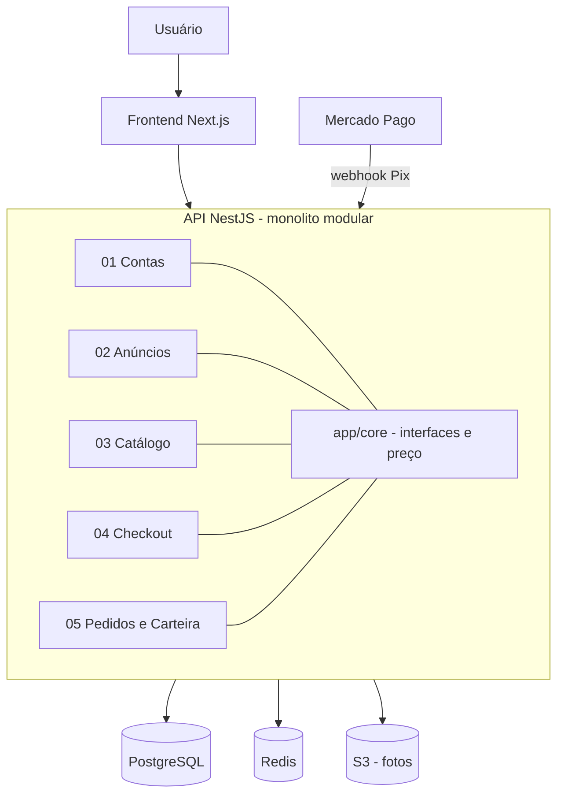

<div align="center">

# Desa Pego

### Brechó online comunitário

Qualquer pessoa anuncia suas roupas e calçados, vê na hora quanto vai receber pela venda e o comprador paga via Pix.

[](https://github.com/Mariaclara2424/Desa-Pego/actions/workflows/ci.yml)


[Requisitos](REQUISITOS.md) · [Arquitetura](docs/ARQUITETURA.md) · [Issues](https://github.com/Mariaclara2424/Desa-Pego/issues) · [Quadro do projeto](https://github.com/users/Mariaclara2424/projects/2)

</div>

---

## Sobre o projeto

O **Desa Pego** é um projeto acadêmico que conecta quem quer desapegar de peças paradas no armário com quem procura moda acessível e circular.

- **Para quem vende:** cadastra a peça com fotos, usa o simulador para ver o valor líquido que vai receber e acompanha o saldo na carteira.
- **Para quem compra:** busca e filtra a vitrine, reserva a peça no checkout e paga com Pix.
- **Para quem administra:** define comissão, taxas e frete, registra os repasses e modera anúncios.

Uma mesma conta pode comprar e vender. Ela passa a vender ao cadastrar uma chave Pix.

## Como funciona uma venda

```mermaid
flowchart LR
    A[Vendedor anuncia a peça] --> B[Simulador mostra o valor líquido]
    B --> C[Peça aparece na vitrine]
    C --> D[Comprador inicia o checkout]
    D --> E[Peça fica reservada por 15 min]
    E --> F[Pagamento via Pix]
    F --> G[Webhook confirma o pagamento]
    G --> H[Vendedor envia a peça]
    H --> I[Comprador confirma o recebimento]
    I --> J[Saldo liberado na carteira]
```



## Módulos do MVP

O MVP tem **15 requisitos** divididos em **5 módulos independentes**, um para cada integrante. Os módulos só conversam entre si pelas interfaces de `app/core`.

| Módulo | Requisitos | Responsável |
| --- | --- | --- |
| **01** · Contas e Perfil do Vendedor | [#1](../../issues/1) Cadastro e Login · [#2](../../issues/2) Perfil com Chave Pix · [#3](../../issues/3) Testes | Clarice Nunes ([@claricenunes](https://github.com/claricenunes)) |
| **02** · Anúncios e Simulador de Ganho | [#4](../../issues/4) Criar e Gerenciar Anúncio · [#5](../../issues/5) Simulador e Preço Sugerido · [#6](../../issues/6) Testes | Lívia Morais ([@livmoorais](https://github.com/livmoorais)) |
| **03** · Catálogo e Detalhes da Peça | [#7](../../issues/7) Vitrine com Busca e Filtros · [#8](../../issues/8) Detalhes da Peça · [#9](../../issues/9) Testes | Helena Furtado ([@helenafurtadoo](https://github.com/helenafurtadoo)) |
| **04** · Carrinho, Checkout e Pix | [#10](../../issues/10) Carrinho com Reserva · [#11](../../issues/11) Checkout com Pix · [#12](../../issues/12) Testes | Marina Almeida ([@Marinasz05](https://github.com/Marinasz05)) |
| **05** · Pedidos, Carteira e Administração | [#13](../../issues/13) Status do Pedido · [#14](../../issues/14) Carteira e Painel do Admin · [#15](../../issues/15) Testes | Maria Clara Pedrosa ([@Mariaclara2424](https://github.com/Mariaclara2424)) |

Os detalhes e critérios de aceitação de cada requisito estão no [REQUISITOS.md](REQUISITOS.md).

## Tecnologias

| Camada | Tecnologia |
| --- | --- |
| Frontend | Next.js (React) com TypeScript, SSR/ISR |
| Backend | NestJS (Node.js 20) com TypeScript, monolito modular |
| Banco de dados | PostgreSQL, com busca full-text |
| Cache, reservas e filas | Redis + BullMQ |
| Fotos das peças | Amazon S3 (MinIO no ambiente local) |
| Pagamento | Pix via `PagamentoProvider` (Mercado Pago; `PixSimuladoProvider` em dev e testes) |
| Testes | Jest + Supertest |
| CI | GitHub Actions + gitleaks |

## Arquitetura



A decisão completa, com os motivos de cada escolha, está no [Documento de Arquitetura](docs/ARQUITETURA.md).

## Como contribuir

1. Pegue sua issue no [quadro do projeto](https://github.com/users/Mariaclara2424/projects/2) e mova para **In Progress**.
2. Trabalhe na branch do requisito, no padrão `feature/<numero>-<slug>`:
   ```bash
   git checkout feature/001-cadastro-login
   ```
3. Faça commits pequenos e com mensagens claras.
4. Abra um Pull Request para a `main` usando o template e escreva `Closes #<numero>`. Mova a issue para **Review**.
5. O PR só entra na `main` com **CI verde** e **1 aprovação**.

### Revisão em rodízio

Cada pessoa revisa os PRs do módulo seguinte ao seu. O GitHub pede a revisão automaticamente pelo arquivo `.github/CODEOWNERS`.

```
01 revisa 02  →  02 revisa 03  →  03 revisa 04  →  04 revisa 05  →  05 revisa 01
```

### Definição de pronto

- [ ] critérios de aceitação atendidos
- [ ] validação no backend (o frontend só esconde opções, nunca é a barreira)
- [ ] testes do requisito passando na CI da branch
- [ ] endpoint documentado no OpenAPI (quando houver)
- [ ] revisado por outra integrante

### Regras do grupo

- Cada módulo funciona sozinho. Nos testes, as interfaces de `app/core` são mockadas.
- Não altere `app/core` sem justificativa e aprovação do grupo.
- Nunca suba o `.env` ou chaves. Use o [`.env.example`](.env.example) como modelo. A CI roda o gitleaks para detectar segredos.

## Integração contínua

O workflow [`ci.yml`](.github/workflows/ci.yml) roda em todo push para `feature/**` e em todo PR para a `main`:

| Job | O que faz |
| --- | --- |
| **Lint e testes** | Node 20 com cache, `npm ci`, lint e Jest, com PostgreSQL e Redis como serviços |
| **Detecção de segredos** | gitleaks em todo o histórico do repositório |

## Fora do MVP

Ficam para depois da primeira entrega:

- cartão de crédito e boleto
- repasse automático e frete calculado com rastreio
- login com Google e 2FA no painel do admin
- avaliações, disputas, favoritos e notificações por e-mail
- contador de impacto ambiental, passaporte da peça e outras ideias de economia circular

---

<div align="center">

Projeto acadêmico desenvolvido por **Clarice Nunes, Lívia Morais, Helena Furtado, Marina Almeida e Maria Clara Pedrosa**.

</div>
